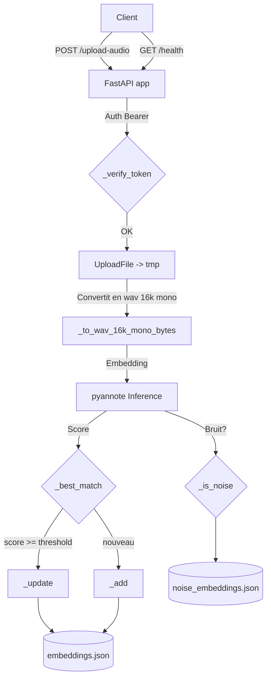

# 🧠 API Diarization — Audio Speaker Embedding & Identification (FastAPI)

Service FastAPI de **diarisation audio optimisée** : il extrait des **embeddings vocaux** localement à l’aide de [`pyannote/wespeaker`](https://huggingface.co/pyannote/wespeaker-voxceleb-resnet34-LM), identifie les locuteurs déjà connus ou enregistre de nouveaux profils, et filtre les segments de **bruit**.
Ce projet fusionne les anciennes APIs `api-audio2embedding` et `api-diarization` en un **service unique**.

---

## 🚀 Fonctionnalités

* 🔊 **Extraction d’embeddings audio** localement (pas d’appel réseau)
* 👤 **Identification des locuteurs** par similarité cosinus
* 🧠 **Apprentissage incrémental** : mise à jour automatique des embeddings connus
* 🧹 **Purge automatique** des embeddings anciens (TTL configurable)
* 🪫 **Détection de bruit** : segments courts ou bruit de fond ignorés
* 🪪 **Sécurisation** par jeton `Bearer`
* 🐳 Prêt pour **Docker / Kubernetes**

---

## 🗺️ Diagramme (app.py)



---

## 🔍 Revue de l’algorithme (doc ↔ code)

Cette section décrit le comportement **réellement implémenté** dans `app.py` pour aligner la doc avec le code.

### Ordre exact des décisions dans `POST /upload-audio/`

1. Le fichier uploadé est écrit en temporaire, puis converti en WAV 16 kHz mono.
2. La durée est estimée à partir de la taille PCM (`len(wav_bytes) / (2 * 16000)`).
3. L’embedding est calculé via `pyannote` en threadpool.
4. La détection de bruit (`_is_noise`) est exécutée **avant toute autre décision**, quelle que soit la durée.
   - Si bruit détecté : retour immédiat `noise: true` avec identifiant `noise-<uuid>`.
5. Si `duration < 3` secondes :
   - s’il n’existe aucun locuteur connu : `identifier: "noise-0"`, `noise: true`;
   - sinon : retour du meilleur locuteur (`_best_match`) avec `added: false` (même si score faible).
6. Si `duration >= 3` secondes :
   - meilleur score trouvé via similarité cosinus;
   - si `score >= SIMILARITY_THRESHOLD` : mise à jour incrémentale (`_update`) et `updated: true`;
   - sinon : création d’un nouveau profil (`_add`) et `added: true`.

### Détails importants côté stockage

- Les embeddings locuteurs sont normalisés L2 à l’insertion et à la mise à jour.
- La mise à jour d’un locuteur fait une moyenne `(old + new)/2`, puis renormalise.
- Les accès JSON sont protégés par `filelock`.
- La purge périodique supprime uniquement les entrées de `embeddings.json` selon `RETENTION_HOURS`.

---

## 📦 Installation

### 1. Dépendances système

Assurez-vous d’avoir `ffmpeg` installé pour le support audio multi-format :

```bash
sudo apt update && sudo apt install -y ffmpeg
```

### 2. Créer un environnement Python

```bash
python3 -m venv venv
source venv/bin/activate
pip install -U pip
```

### 3. Installer les dépendances Python

```bash
pip install -r requirements.txt
```

Exemple de `requirements.txt` minimal :

```txt
fastapi
uvicorn
pydub
numpy
filelock
torch
pyannote.audio
```

---

## ⚙️ Variables d’environnement

| Variable               | Description                                                    | Défaut                                    |
| ---------------------- | -------------------------------------------------------------- | ----------------------------------------- |
| `API_TOKENS`           | Liste de tokens `Bearer` autorisés (séparés par virgule)       | –                                         |
| `EMB_MODEL_ID`         | Modèle Hugging Face utilisé pour les embeddings                | `pyannote/wespeaker-voxceleb-resnet34-LM` |
| `EMB_DEVICE`           | Périphérique d’inférence : `cuda` ou `cpu`                     | auto                                      |
| `EMB_WINDOW`           | Fenêtre d’inférence `pyannote` (`whole` recommandé)            | `whole`                                   |
| `EMBEDDING_STORE`      | Chemin du fichier JSON des embeddings locuteurs                | `embeddings.json`                         |
| `NOISE_STORE`          | Chemin du fichier JSON des embeddings de bruit                 | `noise_embeddings.json`                   |
| `SIMILARITY_THRESHOLD` | Seuil de similarité pour considérer deux voix comme identiques | `0.6`                                     |
| `NOISE_THRESHOLD`      | Seuil pour filtrer les segments de bruit                       | `0.5`                                     |
| `RETENTION_HOURS`      | Durée de conservation des embeddings en heures                 | `1`                                       |
| `PURGE_INTERVAL`       | Intervalle de purge automatique (secondes)                     | `3600`                                    |

---

## ▶️ Lancement

### En développement

```bash
uvicorn app:app --host 0.0.0.0 --port 8000
```

### En production (ex. systemd ou Docker)

```bash
python3 app.py
```

---

## 📡 Endpoints disponibles

### 🔐 `POST /upload-audio/`

Analyse un segment audio, génère son embedding, et tente d’identifier le locuteur.

**Headers :**

* `Authorization: Bearer <TOKEN>`

**Body (multipart/form-data) :**

* `file`: Fichier audio (`.wav`, `.ogg`, `.webm`, `.mp3`, etc.)

**Réponse (JSON) :**

```json
{
  "identifier": "d5bc7c3f-5c83-4d39-8bfa-8f3b3d6d4aa7",
  "noise": false,
  "duration": 5.23,
  "similarity": 0.83,
  "updated": true
}
```

| Champ               | Description                                                                  |
| ------------------- | ---------------------------------------------------------------------------- |
| `identifier`        | ID unique de la voix reconnue ou ajoutée                                     |
| `noise`             | `true` si segment considéré comme bruit                                      |
| `duration`          | Durée du segment analysé (secondes)                                          |
| `similarity`        | Similarité cosinus avec la voix connue la plus proche                        |
| `added` / `updated` | Indique si une nouvelle voix a été ajoutée ou une voix existante mise à jour |

### Comportement pour les segments courts (`duration < 3s`)

* Si l’empreinte est reconnue comme bruit (`NOISE_THRESHOLD`) :
  * la réponse renvoie `noise: true` avec un identifiant `noise-<uuid>`.
* Si aucun locuteur n’existe encore en base :
  * la réponse renvoie `noise: true` avec `identifier: "noise-0"`.
* Sinon :
  * la réponse renvoie le meilleur locuteur connu avec `added: false`.

---

### 🔎 `GET /health`

Vérifie l’état du service et du modèle.

**Headers :**

* `Authorization: Bearer <TOKEN>`

**Réponse :**

```json
{
  "status": "ok",
  "device": "cuda",
  "model": "pyannote/wespeaker-voxceleb-resnet34-LM"
}
```

---

## 🧪 Exemple d’utilisation (cURL)

```bash
curl -X POST "http://localhost:8000/upload-audio/" \
  -H "Authorization: Bearer my-secret-token" \
  -F "file=@/path/to/sample.wav"
```

---

## 🧠 Fichiers d’embeddings

* 📁 `embeddings.json` – stockage des profils de voix connus
* 📁 `noise_embeddings.json` – stockage des profils considérés comme bruit

> Ces fichiers sont verrouillés par `filelock` pour éviter les accès concurrents.

---

## 🛠️ Astuces de production

* Lancer avec `--workers N` (Gunicorn/Uvicorn) pour gérer plusieurs requêtes concurrentes.
* Monter `embeddings.json` sur un volume persistant (`PersistentVolumeClaim` en Kubernetes).
* Ajuster `SIMILARITY_THRESHOLD` pour améliorer la précision selon votre cas d’usage.
* Ajuster `NOISE_THRESHOLD` si des segments très courts sont souvent classés à tort en bruit.
* Par défaut, les tokens sont lus depuis `API_TOKENS` (liste séparée par des virgules).

---

## 📊 Cas d’usage

* 🎙️ Centre d’appels — reconnaître les interlocuteurs automatiquement
* 🧑‍⚖️ Forensic audio — identification de locuteurs sur des extraits courts
* 📞 VoIP monitoring — filtrage bruit / détection changement de locuteur
* 🪶 RAG vocal — associer automatiquement un segment audio à un profil d’utilisateur

---

## 🧑‍💻 Licence

Ce projet est distribué sous licence MIT.
⚠️ L’utilisation commerciale de certains modèles `pyannote` peut nécessiter une licence Hugging Face.

---

## 🧬 Crédits

* [pyannote.audio](https://github.com/pyannote/pyannote-audio) — embeddings et diarisation audio
* [wespeaker](https://github.com/wenet-e2e/wespeaker) — backbone d’extraction vocale
* [FastAPI](https://fastapi.tiangolo.com/) — framework web asynchrone
